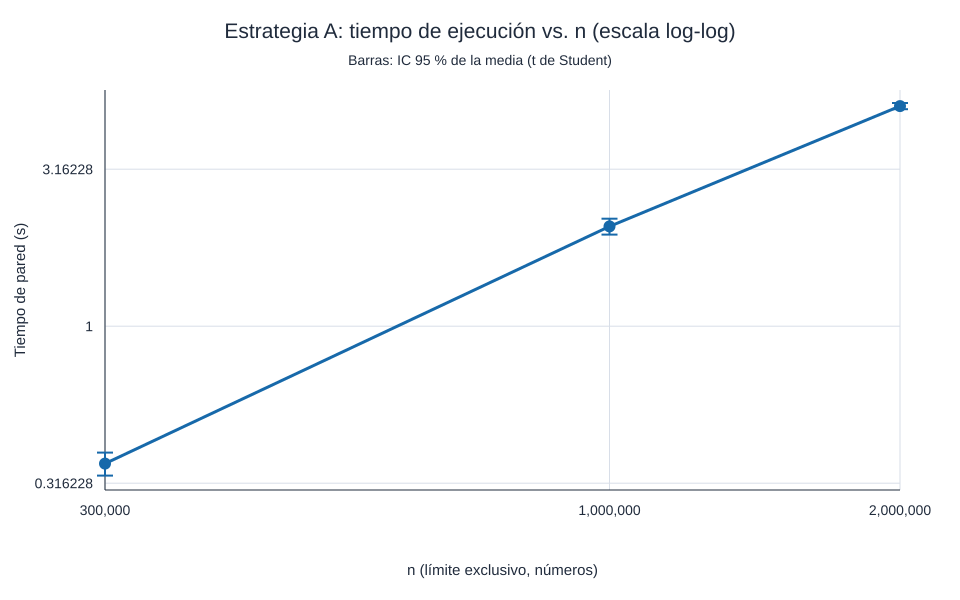
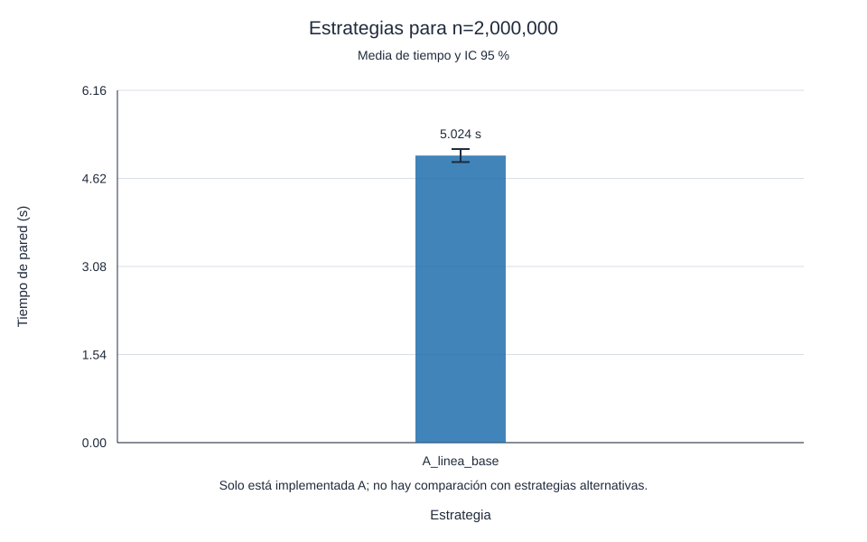

# Informe de análisis — Estrategia A

**Equipo:** 3 · **Fecha de medición:** 2026-11-18 · **Análisis:** 2026-11-25 · **Rama:** `pabon`

## Resumen

Se analizó el CSV formal de la línea base secuencial para tres límites de entrada y diez repeticiones por tamaño. El tiempo medio fue 0,3651 s para n=300 000, 2,0786 s para n=1 000 000 y 5,0236 s para n=2 000 000. El primer caso tuvo CV de 11,77 % y conserva todas sus repeticiones. No hay estrategias paralelas en este conjunto, por lo que estos resultados no miden aceleración multinúcleo ni energía.

## 1. Introducción

AgroDatos requiere contar primos y la implementación A usa un solo proceso. En esta fase se caracteriza el costo temporal al aumentar n en la misma máquina; no se compara el efecto de variar procesos.

## 2. Hipótesis

La tabla de hipótesis del equipo estaba vacía antes de este análisis. No se formulan hipótesis retrospectivas con estos datos; el contraste formal queda pendiente de una predicción registrada antes de una nueva medición. El verificador local reporta H1–H3 como no evaluables; véase [`contraste_hipotesis.md`](contraste_hipotesis.md) y [`hipotesis.md`](hipotesis.md).

## 3. Método

- Estrategia: A, conteo secuencial por lotes de 50 000 números; únicamente A está implementada.
- VI: límite exclusivo n = 300 000, 1 000 000 y 2 000 000. VD principal: tiempo de pared de `ejecutar(lotes)`, medido con `time.perf_counter()`.
- Diez repeticiones temporizadas por combinación, una corrida de calentamiento y orden pseudoaleatorio con semilla 42. La preparación ocurre antes del cronómetro.
- El CSV tiene una corrida de memoria separada por tamaño. Se excluye de estadísticas de tiempo porque `tracemalloc` altera el tiempo.
- Entorno e instrumentación: [`entorno.md`](entorno.md); protocolo detallado: [`protocolo.md`](protocolo.md).

## 4. Resultados

Resumen calculado desde las treinta corridas temporizadas. El intervalo de confianza del 95 % para la media usa t de Student con 9 grados de libertad (t=2,262).

| Estrategia | n | Repeticiones | Media [s] | Desv. estándar [s] | CV [%] | IC95 % media [s] |
|---|---:|---:|---:|---:|---:|---:|
| A_linea_base | 300 000 | 10 | 0,365137 | 0,042983 | 11,77 | [0,334391; 0,395883] |
| A_linea_base | 1 000 000 | 10 | 2,078560 | 0,170129 | 8,18 | [1,956866; 2,200254] |
| A_linea_base | 2 000 000 | 10 | 5,023589 | 0,158914 | 3,16 | [4,909917; 5,137261] |

El resumen CSV generado es [`../resultados/resumen_estadistico.csv`](../resultados/resumen_estadistico.csv). Las tres mediciones separadas de pico de memoria con `tracemalloc` fueron 0,003 MiB. No hubo medición de RSS, temperatura, frecuencia ni energía.

La revisión exploratoria de Tukey señaló 0,449336 s (repetición 7) para n=300 000 y 5,468558 s (repetición 3) para n=2 000 000. No hay causas confirmadas en la bitácora; se conservan todas las observaciones. Para n=300 000, una sensibilidad hipotética sin la repetición 7 daría media 0,355781 s y CV 9,30 %, frente a 0,365137 s y 11,77 % usando todos los datos. El resumen oficial utiliza siempre las diez corridas. Detalles: [`analisis_atipicos.md`](analisis_atipicos.md).

### Tiempo vs. tamaño de entrada

Las escalas de ambos ejes son logarítmicas. Los puntos representan la media de diez corridas; las barras muestran IC95 % de la media. El archivo es reproducible mediante `python herramientas\graficar_resultados.py resultados\resultados.csv`.

### Estrategias para el tamaño máximo

La gráfica muestra el único resultado disponible para n=2 000 000. No es una comparación entre estrategias: B y C todavía no están implementadas ni medidas.

## 5. Discusión

El proceso usa casi un núcleo durante las corridas. Entre n=300 000 y n=2 000 000, el tiempo medio aumentó 13,76 veces para un aumento de n de 6,67 veces (exponente empírico ≈1,38 en estos extremos). La prueba de primalidad recorre divisores hasta encontrar uno o alcanzar la raíz cuadrada del candidato, por lo que el costo por entero puede crecer. No se midieron operaciones ni frecuencia, así que esta es una explicación compatible con el código, no una medición directa de ciclos.

La memoria `tracemalloc` (0,003 MiB) empieza después de preparar la lista de lotes y solo registra asignaciones durante `ejecutar`; no representa el uso completo de memoria. No hubo medición de ancho de banda, energía, potencia, frecuencia o temperatura. Por tanto no se infieren ahorro de energía ni calentamiento/estrangulamiento térmico observados. Véase [`explicacion_fisica.md`](explicacion_fisica.md) para magnitudes, supuestos y limitaciones.

## 6. Propuesta de mejora para la empresa

Mantener A como referencia y ejecutar un piloto con procesos antes de decidir despliegue. Criterio propuesto (no medido): exigir al menos 20 % de reducción media y que el IC95 % de la reducción pareada sea positivo. Esto corresponde a objetivos ≤1,663 s para n=1 000 000 y ≤4,019 s para n=2 000 000 en el entorno medido. Repetir n=300 000 porque su CV actual es 11,77 %. No afirmar ahorro energético sin RAPL/vatímetro. Condiciones de validez, diseño del piloto y riesgos: [`recomendacion.md`](recomendacion.md).

## 7. Conclusiones

La línea base responde correctamente y su duración crece con n; CV supera el umbral orientativo de 10 % en n=300 000. Los resultados son preliminares y específicos de esta máquina y versión de Python. La evidencia disponible no determina si paralelizar mejora el tiempo ni la energía; la recomendación es medirlo antes de desplegar.

## 8. Referencias

- CSV y condiciones medidos: [`../resultados/resultados.csv`](../resultados/resultados.csv), [`../resultados/resultados.entorno.json`](../resultados/resultados.entorno.json).
- Protocolo del equipo: [`protocolo.md`](protocolo.md).

## Anexo: uso de IA

La asistencia se registra en [`uso_ia.md`](uso_ia.md); los cálculos estadísticos son reproducibles mediante el analizador local y los tests.
